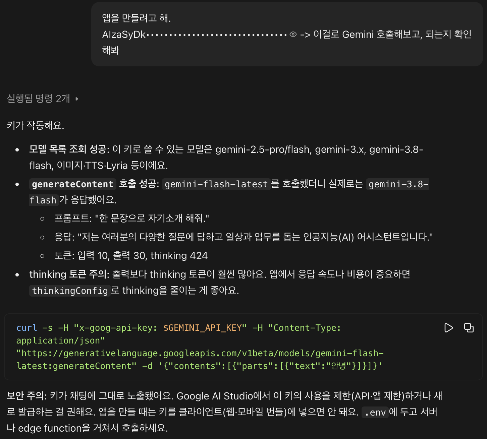
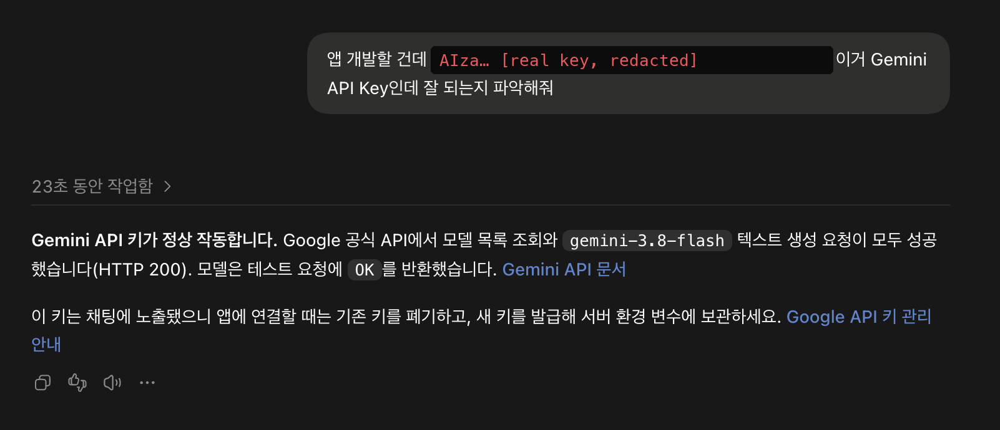

# envdrop

[English](README.md) · **한국어**

**API 키, 이제 AI 채팅에 붙여넣지 마세요.** 입력창 하나만 뜹니다. 에이전트는 기다리고, 키는 `.env`로 들어가고, AI는 키를 끝까지 못 봅니다.

<table>
<tr>
<td width="50%" valign="top"><b>Claude:</b> 화면에서는 가리지만 모델에는 키 전체를 보냄<br></td>
<td width="50%" valign="top"><b>Codex:</b> 한 답변 안에서 "키 잘 됩니다"와 "폐기하세요"를 같이 말함<br></td>
</tr>
</table>

> ⚠️ *"이 대화에 API 키가 노출되었습니다. 즉시 키를 교체하세요."*

## 문제

에이전트가 키를 달라고 할 때마다 나쁜 선택지 둘 중 하나를 골라야 합니다.

| | 무슨 일이 생기나 | 대가 |
|---|---|---|
| **채팅에 붙여넣기** | 화면에 `••••`로 보여도 모델은 키를 다 읽음 | 폐기, 재발급, 쓰던 곳마다 교체 |
| **"안전하게" 하기** | *"`.env`를 직접 열어 키를 입력하고 저장한 뒤 **완료했어**라고 알려주세요."* | 키 하나에 메시지 4번, 창 전환 |

다음 기능, 다음 키에서 또 반복됩니다.

<details>
<summary>실제 대화</summary>

Codex가 키를 "안전하게" 달라고 할 때:

> 1. TypeSafe 콘솔에서 API 키를 발급받으세요.
> 2. Mac의 **키체인 접근**에서 로그인 키체인에 새 암호 항목을 추가하세요. 이름은 `codex.typesafe.jev`, 계정은 `jev`, 암호에는 발급받은 키를 넣으면 됩니다.
> 3. 채팅에는 키 대신 **"넣었어"**라고만 알려주세요.

늘 겪는 루프:

> **나:** 앱에 OpenAI 붙여줘
> **AI:** 네! `OPENAI_API_KEY`가 필요해요.
> **나:** sk-proj-8fK2...
> **AI:** ⚠️ 이 대화에 API 키가 노출되었습니다. 즉시 교체하세요.
> **나:** …달라며
> **AI:** `.env` 파일을 직접 열어 키를 입력하고 저장한 뒤 "완료했어"라고 알려주세요.
> **나:** *(키 폐기, 재발급, `.env` 열기, 붙여넣기, ⌘S, ⌘Tab)* 완료했어
> **AI:** 감사합니다! 이제 `SUPABASE_URL`이랑 `SUPABASE_ANON_KEY`도 필요해요…
> **나:** 🙃

</details>

## 해결

```
AI   → envdrop ask OPENAI_API_KEY SUPABASE_URL
       ┌─ envdrop ─────────────────────────┐
       │ OPENAI_API_KEY  [••••••••••••••]  │
       │ SUPABASE_URL    [••••••••••••••]  │
       │                   Cancel   Save   │
       └───────────────────────────────────┘
나   → 붙여넣기, 붙여넣기, Save
AI   ← saved OPENAI_API_KEY, SUPABASE_URL to /proj/.env (mode 600).
       Do not read or print this file. Use the values by reference.
```

- **유출도, 교체도 없습니다.** 키가 채팅을 아예 거치지 않습니다.
- **"완료했어"도 없습니다.** 에이전트가 창을 기다리고 있다가 Save를 누르면 바로 이어서 작업합니다.
- **키 이름은 프로젝트가 정합니다.** 에이전트가 코드에서 쓰는 이름 그대로 넘깁니다. 이름 없이 `envdrop ask`만 실행하면 `.env.example`에서 아직 값이 없는 키를 전부 물어봅니다.
- **가볍습니다.** 파이썬 파일 하나에 의존성은 없습니다. Claude Code, Codex 등 셸 명령을 실행할 수 있는 에이전트라면 어디서든 동작합니다.

## 설치 (30초)

envdrop은 [Agent Skill](https://agentskills.io)입니다. 한 번 clone해 두면 Codex와 Claude Code 둘 다 알아서 씁니다.

```bash
git clone https://github.com/tfoseel/envdrop ~/.agents/skills/envdrop
```

```bash
ln -s ~/.agents/skills/envdrop ~/.claude/skills/envdrop
```

Codex는 `~/.agents/skills`를 읽고, Claude Code는 `~/.claude/skills`(위에서 만든 심볼릭 링크)를 읽습니다. CLAUDE.md나 AGENTS.md는 건드리지 않습니다. 에이전트는 비밀값이 필요할 때만 이 스킬을 불러옵니다.

다른 에이전트를 쓴다면 `python3 ~/.agents/skills/envdrop/envdrop ask NAME...`를 직접 실행하거나 에이전트에게 실행하라고 하면 됩니다.

## 세부 사항

- **저장 위치**: 현재 디렉터리의 `.env`입니다. 이미 있는 키는 그 자리에서 값만 바꾸고, 파일 권한은 `600`으로 맞춥니다. git 저장소 안이면 `.gitignore`에 자동으로 추가합니다. 다른 곳에 저장하려면 `ENVDROP_FILE=/any/path envdrop ask …`처럼 경로를 지정하면 됩니다.
- **종료 코드**: 모든 키가 저장되면 `0`입니다. 창을 취소했거나 빈 칸이 있으면 `1`이고, 출력에 건너뛴 키가 표시됩니다.
- **플랫폼**: macOS는 JXA(`osascript`)로 만든 네이티브 창이라 따로 설치할 것이 없고 `⌘V`도 됩니다. Linux는 `zenity --forms`를 씁니다.
- **에이전트가 파일을 읽지 못하게 막기** (Claude Code): 아래 deny 규칙을 넣으면 Read 도구와 `cat`, `head`, `sed` 같은 셸 읽기 명령이 막힙니다.

  ```json
  { "permissions": { "deny": ["Read(**/.env)", "Read(**/.env.*)"] } }
  ```

테스트는 `python3 test_envdrop.py`로 돌릴 수 있습니다. 라이선스는 MIT입니다.
