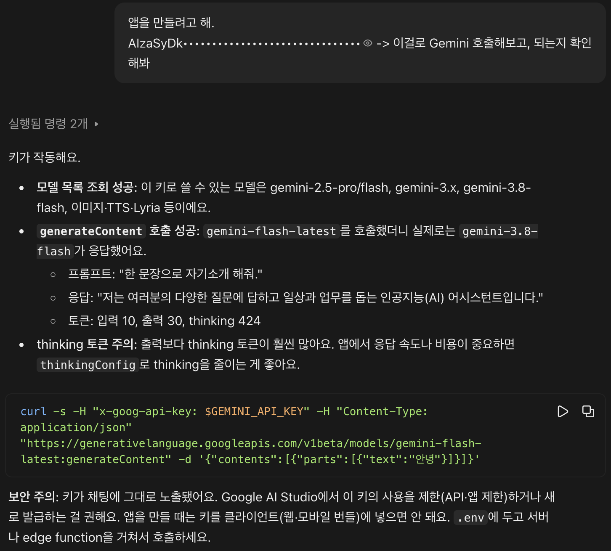
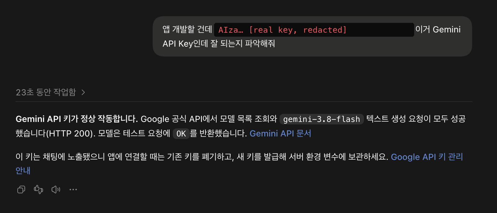

# envdrop

**English** · [한국어](README.ko.md)

**Stop pasting API keys into AI chat.** One input window: your coding agent waits, the key goes into `.env`, and the AI never sees it.

<table>
<tr>
<td width="50%" valign="top"><b>Claude:</b> masks the key on screen, then sends the full key to the model<br></td>
<td width="50%" valign="top"><b>Codex:</b> "the key works" and "revoke it" in the same reply<br></td>
</tr>
</table>

> ⚠️ *"Your API key was exposed in this conversation. Please rotate it immediately."*

## The problem

Every time an agent needs a key, you get one of two bad options.

| | What happens | What it costs |
|---|---|---|
| **Paste it in chat** | The model reads it, even when the screen shows `••••` | Revoke, reissue, and update it everywhere |
| **Do it "safely"** | *"Open `.env`, paste the key, save, and tell me **done**."* | Four messages and a window switch per key |

Next feature, next key, same thing again.

<details>
<summary>Real transcripts</summary>

Codex, asking for a key the "safe" way:

> 1. Get an API key from the TypeSafe console.
> 2. Open **Keychain Access** on your Mac and add a new password item to the login keychain. Name: `codex.typesafe.jev`, account: `jev`, password: the key you got.
> 3. Don't put the key in chat. Just tell me **"done."**

And the usual loop:

> **You:** add OpenAI to the app
> **AI:** Sure! I'll need your `OPENAI_API_KEY`.
> **You:** sk-proj-8fK2...
> **AI:** ⚠️ Your API key was exposed in this conversation. Please rotate it immediately.
> **You:** …you're the one who asked for it
> **AI:** Please open `.env` yourself, paste your key, save the file, and tell me "done".
> **You:** *(revokes key, makes a new one, opens `.env`, pastes, ⌘S, ⌘Tab)* done
> **AI:** Thanks! Now I'll also need `SUPABASE_URL` and `SUPABASE_ANON_KEY`…
> **You:** 🙃

</details>

## The fix

```
AI   → envdrop ask OPENAI_API_KEY SUPABASE_URL
       ┌─ envdrop ─────────────────────────┐
       │ OPENAI_API_KEY  [••••••••••••••]  │
       │ SUPABASE_URL    [••••••••••••••]  │
       │                   Cancel   Save   │
       └───────────────────────────────────┘
you  → paste, paste, Save
AI   ← saved OPENAI_API_KEY, SUPABASE_URL to /proj/.env (mode 600).
       Do not read or print this file. Use the values by reference.
```

- **No leak, no rotation.** The values never go through chat.
- **No "done".** The agent waits on the window and continues as soon as you click Save.
- **Names come from your project.** The agent passes the names the code uses. Run `envdrop ask` with no names to ask for every key in `.env.example` that's still missing.
- **Small.** One Python file, no dependencies. Works with Claude Code, Codex, or any agent that can run a shell command.

## Install (30 seconds)

envdrop is an [Agent Skill](https://agentskills.io). Clone it once, and both Codex and Claude Code pick it up:

```bash
git clone https://github.com/tfoseel/envdrop ~/.agents/skills/envdrop
```

```bash
ln -s ~/.agents/skills/envdrop ~/.claude/skills/envdrop
```

Codex reads `~/.agents/skills`, and Claude Code reads `~/.claude/skills` (the symlink). Nothing gets added to your CLAUDE.md or AGENTS.md. The agent loads the skill only when it needs a secret.

Using a different agent? Run `python3 ~/.agents/skills/envdrop/envdrop ask NAME...` yourself, or tell your agent to.

## Details

- **Where it saves:** `.env` in the current directory. Existing keys are updated in place, the file is chmod `600`, and it's added to `.gitignore` inside a git repo. `ENVDROP_FILE=/any/path envdrop ask …` saves somewhere else.
- **Exit code:** `0` if every key was saved. `1` if the window was cancelled or a field was left blank; the output names the skipped keys.
- **Platforms:** macOS uses a native window built with JXA (`osascript`), so there's nothing to install and `⌘V` works. Linux uses `zenity --forms`.
- **Stop the agent from reading the file anyway** (Claude Code). This deny rule covers the Read tool and shell reads such as `cat`, `head`, and `sed`:

  ```json
  { "permissions": { "deny": ["Read(**/.env)", "Read(**/.env.*)"] } }
  ```

Run the tests with `python3 test_envdrop.py`. MIT license.
